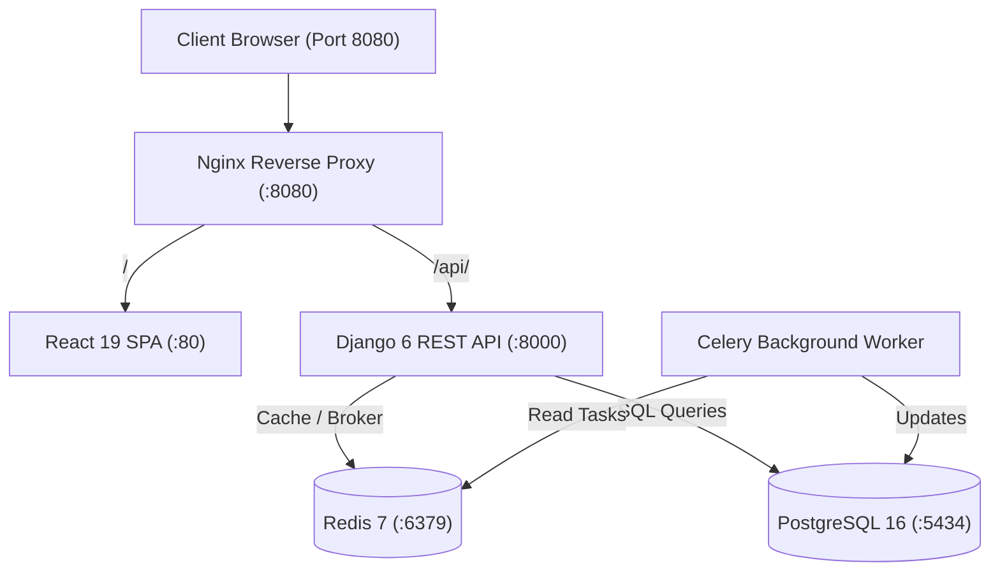

# Amazon Clone — Version 3: Advanced E-Commerce, Discovery & Caching

Welcome to **Version 3** of the Amazon Clone project suite. Version 3 elevates the platform into an advanced e-commerce engine with Redis caching, Celery asynchronous processing, search autocomplete, product comparison, frequently bought together bundles, community Q&A, review voting, flash sales, and a unified Nginx reverse proxy gateway.

---

## 🛠️ Approved Technology Stack

- **Backend**: Django 6.0, Django REST Framework 3.17, SimpleJWT
- **Frontend**: React 19, Vite, Tailwind CSS, React Router, Axios
- **Database**: PostgreSQL 16
- **Caching & Broker**: Redis 7
- **Asynchronous Workers**: Celery 5.4
- **Containerization**: Docker, Docker Compose
- **Orchestration**: Kubernetes
- **Web Server / Reverse Proxy**: Nginx 1.27
- **Strictly Excluded**: Zero references or files for GitHub Actions, Prometheus, or Grafana.

---

## 🎯 Version 3 Real-World E-Commerce Features

1. **Product Comparison**: Side-by-side spec, pricing, rating, and feature comparison (`/api/v1/products/compare/?ids=...`).
2. **Product Recommendation Engine**: Category-aware and similarity-based product discovery (`/api/v1/products/<id>/recommendations/`).
3. **Frequently Bought Together**: Dynamic bundle builder computing instant multi-item bundle discounts (`FrequentlyBoughtTogether.jsx`).
4. **Search Autocomplete**: Live keystroke autocomplete matching titles, categories, and brands with cached lookups.
5. **Search History**: Per-user search query recording and quick retrieval of past searches.
6. **Advanced Product Reviews**: Structured reviews featuring star ratings, review headlines, verified purchase badges, and full text.
7. **Review Image Uploads**: Multi-photo customer review attachments (`ReviewImage` model).
8. **Verified Purchase Badges**: Cryptographically and order-verified review badges awarded exclusively to purchasers.
9. **Review Voting**: Helpful/Unhelpful feedback scoring with voter deduplication (`ReviewVote` model).
10. **Product Questions & Answers (Q&A)**: Interactive community forum per product with customer questions and answers.
11. **Review Moderation**: Admin flagging and moderation workflows to combat spam and fake reviews.
12. **Back-in-Stock Notifications**: Automated alert subscription for out-of-stock items (`BackInStockNotification`).
13. **Flash Sales Engine**: Time-limited lightning deals with percentage discounts and real-time countdown timer banners (`FlashSaleBanner.jsx`).
14. **Related Product Recommendations**: Cross-sell suggestions based on catalog taxonomy and price brackets.

---

## ⚙️ Engineering & Infrastructure Improvements

- **Redis Caching**: Redis-backed high-speed caching for catalog lookups, search suggestions, and flash sales.
- **Celery Background Worker**: Asynchronous queue processing for email dispatch, notification fan-out, and catalog indexing.
- **API Versioning**: Formal API versioning supporting `/api/v1/` routes alongside backward-compatible legacy routes.
- **API Throttling**: DRF rate limiting preventing abuse (`300 requests/minute` for anonymous users, `1200 requests/minute` for authenticated users).
- **Unified Nginx Reverse Proxy**: Single entrypoint on port `8080` routing `/` to the React SPA and `/api/` to the Django backend.
- **PostgreSQL Full-Text Search**: Optimized text matching and indexing across names, descriptions, and categories.

---

## 🏗️ Architecture



---

## 🧪 Automated Testing & Verification

Automated backend test suite covering comparison, recommendations, bundle calculations, Q&A, back-in-stock alerts, flash sales, review voting, and health:

```bash
cd AmazonClone_V3/backend
python manage.py test
```

### Verified Test Results:
```text
Ran 16 tests in 3.912s
OK (16/16 tests passed, 0 failures, 0 errors)
```

Frontend production build verification:
```bash
cd AmazonClone_V3/frontend
npm run build
# Result: 155 modules transformed, built in ~700ms
```

---

## 🚀 Docker Compose Deployment

Version 3 runs a comprehensive 5-container architecture behind the Nginx gateway:

- **Nginx Gateway**: `http://localhost:8080`
- **Swagger / OpenAPI Documentation**: `http://localhost:8080/api/docs/`
- **PostgreSQL**: Port `5434` (`amazon_v3` database)
- **Redis**: Port `6379` (`redis-service`)

```bash
cd AmazonClone_V3
docker compose up --build -d
```

---

## ☸️ Kubernetes Deployment

```bash
cd AmazonClone_V3
kubectl apply -f k8s/secrets.yaml
kubectl apply -f k8s/configmap.yaml
kubectl apply -f k8s/pvc.yaml
kubectl apply -f k8s/database-deployment.yaml
kubectl apply -f k8s/database-service.yaml
kubectl apply -f k8s/backend-deployment.yaml
kubectl apply -f k8s/backend-service.yaml
kubectl apply -f k8s/frontend-deployment.yaml
kubectl apply -f k8s/frontend-service.yaml
kubectl apply -f k8s/ingress.yaml
```

---

## 📊 Operations & Monitoring (Without Prometheus/Grafana)

- **Container Metrics**: `docker stats amazon_v3_proxy amazon_v3_backend amazon_v3_frontend amazon_v3_celery amazon_v3_redis amazon_v3_postgres`
- **Reverse Proxy Logs**: `docker compose logs -f proxy-service`
- **Celery Worker Logs**: `docker compose logs -f celery-worker`
- **Application Health Check**: `curl -f http://localhost:8080/api/health/`
- **Kubernetes Pod Status**: `kubectl get pods -l app.kubernetes.io/part-of=amazon_v3`
- **Database Backup**: `docker compose exec database-service pg_dump -U amazon_user amazon_v3 > v3_backup.sql`
- **Database Restore**: `docker compose exec -T database-service psql -U amazon_user -d amazon_v3 < v3_backup.sql`
