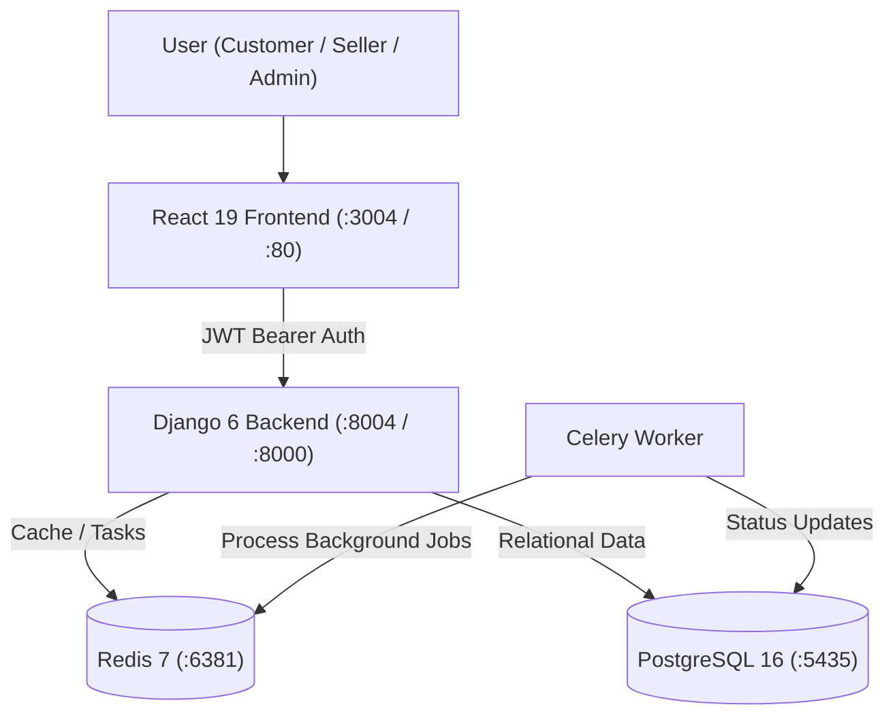

# Amazon Clone — Version 4: Enterprise Multi-Vendor Marketplace (Capstone)

Welcome to **Version 4**, the definitive enterprise capstone of the Amazon Clone project suite. Version 4 implements a complete multi-vendor marketplace featuring **three distinct portals** (Customer, Seller, Admin), multi-vendor order splitting, seller commission accounting, payout workflows, bulk CSV catalog upload, simulated shipping tracking generation, sandbox payments with webhook signature validation, and security audit logging.

---

## 🛠️ Approved Technology Stack

- **Backend**: Django 6.0, Django REST Framework 3.17, SimpleJWT
- **Frontend**: React 19, Vite, Tailwind CSS, React Router, Axios
- **Database**: PostgreSQL 16
- **Caching & Broker**: Redis 7
- **Asynchronous Workers**: Celery 5.4
- **Containerization**: Docker, Docker Compose
- **Orchestration**: Kubernetes
- **Web Server / Reverse Proxy**: Nginx 1.27
- **Strictly Excluded**: Zero references or files for GitHub Actions, Prometheus, or Grafana.

---

## 🏛️ The Three Marketplace Portals

### 1. Customer Portal
- Complete catalog browsing, filtering, and search.
- Multi-vendor cart: Products from different sellers are added into a single unified cart.
- Transaction-safe checkout with simulated payment gateway.
- Order tracking with seller-level line-item fulfillment statuses (`pending`, `shipped`, `delivered`).
- Customer review submissions and query threads with sellers.

### 2. Seller Portal (`/seller/dashboard`)
- **Seller Registration & Onboarding**: Business credentials, tax ID, bank details, and category focus.
- **Product Management**: Manual product CRUD and **Bulk CSV Product Upload** (`name,price,stock,category,description`).
- **Inventory Tracking**: Stock counts, low-stock warnings, and pricing controls.
- **Order Fulfillment**: Line-item order view with **Shipment Generation** (Delhivery / BlueDart tracking number assignment).
- **Financial Reports & Payouts**: Gross sales, units sold, commission deducted, net earnings, available balance, and withdrawal request submission.
- **Customer Query Management**: Direct customer communication and support query resolution.

### 3. Admin & SuperAdmin Portal (`/admin/panel`)
- **Seller Verification**: Review pending seller applications with `Verify`, `Reject`, and `Flag as Fraud` actions.
- **SuperAdmin Cascade Removal**: SuperAdmin-exclusive permanent removal of fraudulent sellers and their associated products.
- **Product & Customer Moderation**: Flag or unflag suspicious listings and abusive accounts.
- **Payout Approvals**: Approve or reject seller payout requests with balance reconciliation.
- **Marketplace Analytics**: Executive dashboard showing Total GMV, Platform Commission, Orders Completed, and Active Sellers.
- **Security Audit Logs**: Centralized immutable audit trail logging actor, role, action, target resource, and IP address.

---

## 💼 Advanced Business Logic & Systems

- **Multi-Vendor Order Splitting**: Single customer orders contain items belonging to multiple sellers. Each seller fulfills only their line items; order-level status updates automatically via `Order.recompute_status()`.
- **Commission Calculation**: Configurable platform commission rate (default 10%) automatically deducted from seller gross earnings.
- **Seller Payout Lifecycle**: Sellers request withdrawals against their available balance; marketplace admins approve and process payouts.
- **Sandbox Payment Gateway**: Payment abstraction simulating card and UPI checkout with cryptographic webhook signature verification (`PaymentTransaction`).
- **Shipping Provider Abstraction**: Generates simulated carrier tracking numbers (`ShippingShipment`) upon dispatch.
- **Role-Based Access Control (RBAC)**: Distinct permissions for Customers, Verified Sellers, Staff Admins, and Django SuperUsers.

---

## 🏗️ Architecture



---

## 🧪 Automated Testing & Verification

Automated backend test suite verifying seller registration, profile retrieval, bulk CSV upload, order shipping, payout lifecycle, sandbox payments, webhook signature validation, and admin analytics:

```bash
cd AmazonClone_V4/backend
python manage.py test
```

### Verified Test Results:
```text
Ran 12 tests in 12.980s
OK (12/12 tests passed, 0 failures, 0 errors)
```

Frontend production build verification:
```bash
cd AmazonClone_V4/frontend
npm run build
# Result: 155 modules transformed, built in ~500ms
```

---

## 🚀 Docker Compose Deployment

Version 4 is configured with independent ports to avoid conflicts:

- **Frontend (with Nginx reverse proxy)**: `http://localhost:3004`
- **Backend API**: `http://localhost:8004/`
- **Health Check**: `http://localhost:8004/health/`
- **PostgreSQL**: Port `5435` (`marketplace_v4` database)
- **Redis**: Port `6381`

```bash
cd AmazonClone_V4
docker compose up --build -d
```

---

## ☸️ Kubernetes Deployment

```bash
cd AmazonClone_V4
kubectl apply -f k8s/secrets.yaml
kubectl apply -f k8s/configmap.yaml
kubectl apply -f k8s/database-deployment.yaml
kubectl apply -f k8s/database-service.yaml
kubectl apply -f k8s/redis-deployment.yaml
kubectl apply -f k8s/redis-service.yaml
kubectl apply -f k8s/backend-deployment.yaml
kubectl apply -f k8s/backend-service.yaml
kubectl apply -f k8s/celery-deployment.yaml
kubectl apply -f k8s/frontend-deployment.yaml
kubectl apply -f k8s/frontend-service.yaml
```

---

## 📊 Operations & Monitoring (Without Prometheus/Grafana)

- **Container Metrics**: `docker stats amazon_v4_frontend amazon_v4_backend amazon_v4_celery amazon_v4_redis amazon_v4_postgres`
- **Container Logs**: `docker compose logs -f backend-service`
- **Application Health Check**: `curl -f http://localhost:8004/health/`
- **Kubernetes Pod Status**: `kubectl get pods -l app.kubernetes.io/part-of=marketplace`
- **Kubernetes Pod Resource Usage**: `kubectl top pods`
- **Database Backup**: `docker compose exec database-service pg_dump -U marketplace marketplace_v4 > v4_backup.sql`
- **Database Restore**: `docker compose exec -T database-service psql -U marketplace -d marketplace_v4 < v4_backup.sql`
