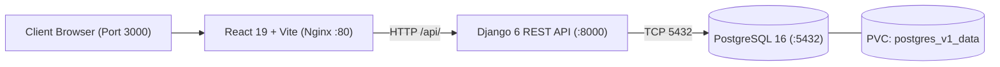

# Amazon Clone — Version 1: Storefront Foundation & Catalog MVP

Welcome to **Version 1** of the Amazon Clone project suite. Version 1 is a feature-rich storefront MVP delivering product variants, an interactive image gallery, guest carts, local wishlists, coupon simulation, stock tracking, and responsive mobile commerce.

---

## 🛠️ Approved Technology Stack

- **Backend**: Django 6.0, Django REST Framework 3.17, SimpleJWT
- **Frontend**: React 19, Vite, Tailwind CSS, React Router, Axios
- **Database**: PostgreSQL 16
- **Containerization**: Docker, Docker Compose
- **Orchestration**: Kubernetes
- **Web Server / Reverse Proxy**: Nginx 1.27
- **Strictly Excluded**: Zero references or files for GitHub Actions, Prometheus, or Grafana.

---

## 🎯 Version 1 Real-World E-Commerce Features

1. **Product Variants**: Full variant schema supporting size, color, SKU suffix, and extra price adjustments.
2. **Multiple Product Images**: Interactive multi-image gallery with thumbnail selection and zoom view (`ProductImage` model).
3. **Product SKU**: Unique stock-keeping units for catalog items (`unique=True`).
4. **Product Sorting**: Dynamic sorting by price (low-to-high, high-to-low), newest arrivals, and customer ratings.
5. **Advanced Product Filtering**: Multi-dimensional filtering by brand, category, price range, and in-stock only availability.
6. **Pagination**: Server-side DRF pagination (`PageNumberPagination`, default 20 items/page).
7. **Product Availability**: Real-time stock status badge (`In Stock`, `Low Stock`, `Out of Stock`).
8. **Stock Management**: Inventory bounds checking and stock availability verification before cart actions.
9. **Recently Viewed Products**: Client-persisted browsing history slider across session visits.
10. **Guest Cart**: Full client-side cart for unauthenticated users with quantity modifiers and order total computation.
11. **Local Wishlist**: Offline wishlist manager with instantaneous save-for-later toggles.
12. **Coupon Simulation**: Real-time coupon validator supporting discount codes (`SAVE10`, `WELCOME20`, `AMAZON50`).
13. **Responsive Mobile UI**: Mobile-optimized layouts featuring touch navigation, responsive drawer, and bottom navigation bar.
14. **Product Image Gallery**: Multi-angle product viewer component (`ProductImageGallery.jsx`).

---

## 🏗️ Architecture



---

## 🧪 Automated Testing & Verification

Automated backend test suite covering models, serializers, cart operations, coupons, variants, and health diagnostics:

```bash
cd AmazonClone_V1/backend
python manage.py test
```

### Verified Test Results:
```text
Ran 17 tests in 3.482s
OK (17/17 tests passed, 0 failures, 0 errors)
```

Frontend production build verification:
```bash
cd AmazonClone_V1/frontend
npm run build
# Result: 151 modules transformed, built in ~600ms
```

---

## 🚀 Docker Compose Deployment

Version 1 uses isolated port allocations and its own persistent volume:

- **Frontend**: `http://localhost:3000`
- **Backend API**: `http://localhost:8000/api/`
- **PostgreSQL**: Port `5432` (`amazon_v1` database)

```bash
cd AmazonClone_V1
docker compose up --build -d
```

---

## ☸️ Kubernetes Deployment

```bash
cd AmazonClone_V1
kubectl apply -f k8s/secrets.yaml
kubectl apply -f k8s/configmap.yaml
kubectl apply -f k8s/pvc.yaml
kubectl apply -f k8s/database-deployment.yaml
kubectl apply -f k8s/database-service.yaml
kubectl apply -f k8s/backend-deployment.yaml
kubectl apply -f k8s/backend-service.yaml
kubectl apply -f k8s/frontend-deployment.yaml
kubectl apply -f k8s/frontend-service.yaml
```

---

## 📊 Operations & Monitoring (Without Prometheus/Grafana)

- **Container Metrics**: `docker stats amazon_v1_backend amazon_v1_frontend amazon_v1_postgres`
- **Container Logs**: `docker compose logs -f backend-service`
- **Application Health Check**: `curl -f http://localhost:8000/api/health/`
- **Kubernetes Pod Status**: `kubectl get pods -l app.kubernetes.io/part-of=amazon_v1`
- **Kubernetes Resource Usage**: `kubectl top pods`
- **Database Backup**: `docker compose exec database-service pg_dump -U amazon_user amazon_v1 > v1_backup.sql`
- **Database Restore**: `docker compose exec -T database-service psql -U amazon_user -d amazon_v1 < v1_backup.sql`
