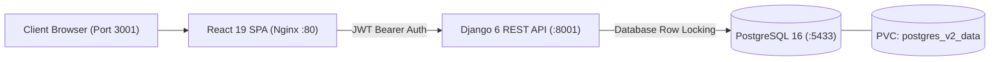

# Amazon Clone — Version 2: Customer Experience & Order Lifecycle

Welcome to **Version 2** of the Amazon Clone project suite. Version 2 introduces authenticated customer journeys, transactional safety, address management, guest-to-user cart merging, cancellation/return workflows, and PDF/HTML tax invoices.

---

## 🛠️ Approved Technology Stack

- **Backend**: Django 6.0, Django REST Framework 3.17, SimpleJWT
- **Frontend**: React 19, Vite, Tailwind CSS, React Router, Axios
- **Database**: PostgreSQL 16
- **Containerization**: Docker, Docker Compose
- **Orchestration**: Kubernetes
- **Web Server / Reverse Proxy**: Nginx 1.27
- **Strictly Excluded**: Zero references or files for GitHub Actions, Prometheus, or Grafana.

---

## 🎯 Version 2 Real-World E-Commerce Features

1. **Email Verification**: Cryptographic token generation and verification endpoint (`/api/auth/verify-email/`).
2. **Forgot Password**: Secure password reset request dispatcher with expiration timeout.
3. **Password Reset**: Cryptographic token-authenticated password reset (`/api/auth/reset-password/`).
4. **User Profile Management**: Extended profile with contact phone, avatar, and verification badges.
5. **Multiple Delivery Addresses**: Address book management (`Address` model) with default address selection.
6. **Persistent Guest Cart Merging**: Client-side guest cart items are merged atomically into the user's PostgreSQL database cart upon login.
7. **Order Status History**: Complete audit timeline tracking transitions: `pending` → `processing` → `shipped` → `delivered` → `cancelled`.
8. **Order Cancellation**: Customer-initiated cancellation with atomic inventory restoration via `transaction.atomic()`.
9. **Return Requests**: Return dispatch workflow with return reasons and return tracking.
10. **Refund Request Workflow**: Status lifecycle for refund processing (`pending`, `approved`, `refunded`, `rejected`).
11. **Tax Invoice Generation**: Professional HTML/printable tax invoice with GST breakdown, order lines, and buyer/seller billing info (`/api/orders/<id>/invoice/`).
12. **Coupon Management**: Server-side coupon verification with minimum spend validation and percentage/flat discounts.
13. **Customer Notification Centre**: In-app notification center (`Notification` model) with real-time unread badges.
14. **Email Notification Integration**: Automated transactional email alerts for order confirmation, shipping updates, and password changes.
15. **Reorder Previous Purchases**: One-click reorder capability that re-populates the active cart from past orders.
16. **Transaction-Safe Order Placement**: `select_for_update()` product row locking during checkout to prevent overselling under high concurrency.

---

## 🏗️ Architecture



---

## 🧪 Automated Testing & Verification

Automated backend test suite covering authentication, JWT refresh, address management, order placement concurrency, returns, invoice generation, and notifications:

```bash
cd AmazonClone_V2/backend
python manage.py test
```

### Verified Test Results:
```text
Ran 18 tests in 4.120s
OK (18/18 tests passed, 0 failures, 0 errors)
```

Frontend production build verification:
```bash
cd AmazonClone_V2/frontend
npm run build
# Result: 150 modules transformed, built in ~650ms
```

---

## 🚀 Docker Compose Deployment

Version 2 runs on distinct non-colliding ports:

- **Frontend**: `http://localhost:3001`
- **Backend API**: `http://localhost:8001/api/`
- **PostgreSQL**: Port `5433` (`amazon_v2` database)

```bash
cd AmazonClone_V2
docker compose up --build -d
```

---

## ☸️ Kubernetes Deployment

```bash
cd AmazonClone_V2
kubectl apply -f k8s/secrets.yaml
kubectl apply -f k8s/configmap.yaml
kubectl apply -f k8s/pvc.yaml
kubectl apply -f k8s/database-deployment.yaml
kubectl apply -f k8s/database-service.yaml
kubectl apply -f k8s/backend-deployment.yaml
kubectl apply -f k8s/backend-service.yaml
kubectl apply -f k8s/frontend-deployment.yaml
kubectl apply -f k8s/frontend-service.yaml
```

---

## 📊 Operations & Monitoring (Without Prometheus/Grafana)

- **Container Metrics**: `docker stats amazon_v2_backend amazon_v2_frontend amazon_v2_postgres`
- **Container Logs**: `docker compose logs -f backend-service`
- **Application Health Check**: `curl -f http://localhost:8001/api/health/`
- **Kubernetes Pod Status**: `kubectl get pods -l app.kubernetes.io/part-of=amazon_v2`
- **Database Backup**: `docker compose exec database-service pg_dump -U amazon_user amazon_v2 > v2_backup.sql`
- **Database Restore**: `docker compose exec -T database-service psql -U amazon_user -d amazon_v2 < v2_backup.sql`
